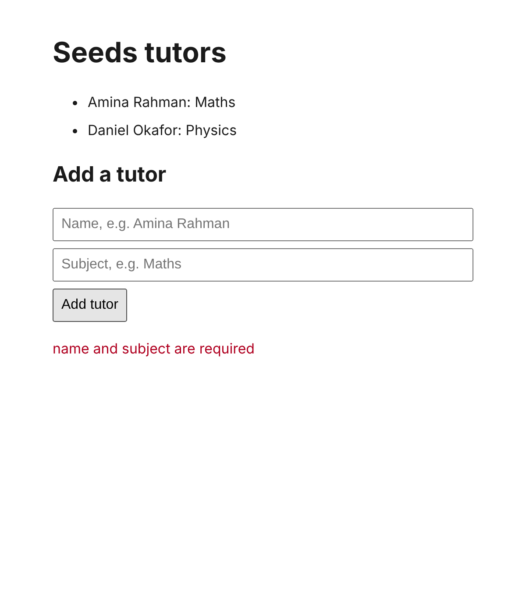

# Build a full app from scratch: database → backend → API → frontend

**Who this is for:** a complete beginner on a Mac. No prior knowledge assumed.
**Time:** about 60–90 minutes, in one sitting or several.
**What you'll have at the end:** a tiny "Seeds tutors" app that you built yourself, with four parts running on your own MacBook:

```
 Your browser                    Your Django                  Your PostgreSQL
 (frontend page,    ──HTTP──▶    program (backend,   ──SQL──▶  database
  port 3000)        ◀─JSON───    port 8000)          ◀─rows──  (port 5432)
```

You'll be able to point at each box, say what it does, and watch a message travel through all of them.

---

## What we're doing, and why it's a separate project

You have **two different projects**. Don't mix them up:

| | `seeds-backend` (already exists) | `seeds-mini` (we create it now) |
|---|---|---|
| What it is | Your real Seeds backend: payments, bookings, emails. About 30 files | A tiny practice backend with ~5 files that **you write** |
| Language | JavaScript (Node) | Python (Django) |
| Where it lives | Your existing folder | New folder `~/seeds-mini` |
| Do we change it? | **No** | Yes, it's all yours |

**Why not just study the real one?** It has dozens of files and hundreds of lines per file, so it's too much to learn from. `seeds-mini` has the **same moving parts at 1/20th of the size**: a database, an API, a frontend. You build each part yourself, so you know what every file does. Afterwards, you open the real `seeds-backend`, and each file will look familiar. You'll recognise "that's the same as my `views.py`".

**The plan:** build `seeds-mini` (this guide) → read the real backend with a map in hand → write a **new endpoint of your own**.

---

## How to use this guide

- Do the parts **in order**. Each part ends with a **✅ Checkpoint**: what you should see. If you see it, move on. If not, go to the **🔧 If something goes wrong** box right under it. There's also a big **Troubleshooting** table near the end.
- **Terminal** = the Mac app where you type commands (press `Cmd + Space`, type `Terminal`, press Enter).
- **Editor** = where you edit code files. Install **VS Code** (free): https://code.visualstudio.com
- When a code block starts with `bash` it's a command you type into **Terminal**, then press **Enter**. Don't type the `$`. Other code blocks are file contents.
- **Every part has the same four ingredients**, so you always know where you are:
  1. **🧠 What & why**: what the thing is and why it exists (read this *before* typing)
  2. **🛠 Steps**: what to type
  3. **✅ Checkpoint** + **🔧 fixes**: what you should see, and what to do if you don't
  4. **🗺️ The picture so far**: a map that fills in as you go, so the whole system builds up piece by piece
- A finished, tested copy of everything lives in `learn/seeds-mini-reference/`. If you ever get lost, compare your file with the one there.
- **You will use two different kinds of window. Mixing them up is the #1 beginner mistake:**

  | | **Database window** | **Normal Terminal** |
  |---|---|---|
  | How to open | Double-click a database in the **Postgres app** | `Cmd + Space`, type `Terminal`, Enter |
  | Prompt looks like | `seeds_mini=#` (ends in `#`) | `azeemmufti@MacBook ~ %` (ends in `%`) |
  | You type | **SQL** (`CREATE DATABASE ...;`, `SELECT ...;`) | **commands** (`cd`, `python3`, `pip`, `python manage.py`) |
  | To leave it | `\q` then Enter | just close it |

  If you type a command like `cd` or `python3` after a prompt ending in `#`, nothing useful happens. Each part below says which window to use.
- **Errors are normal.** Every developer sees them all day. An error message is the computer telling you exactly what it needs. Read the **last line** first.

### The five words you asked about, in one place

| Word | Plain meaning |
|---|---|
| **Server** | A program that waits for requests and answers them. (Also used for the computer it runs on.) Here, "the server" = Django running on your Mac. |
| **Website address (URL)** | Where to send a request. `http://localhost:8000/api/tutors/` = *this computer* (`localhost`), *door number* 8000 (the port), *room* `/api/tutors/` (the path). |
| **HTTP** | The rules of the conversation. The browser sends a **request** (a method like GET or POST, plus an address); the server sends a **response** (a status number like 200 plus data). HTTPS is the same but encrypted. |
| **API** | The list of requests the server understands, meant for other *programs* (not people). Ours will have `GET /api/tutors/` ("list tutors") and `POST /api/tutors/` ("add a tutor"). |
| **Django** | A Python toolkit for writing the server program, so you don't build everything by hand. |

---

## Part 0: Check your tools (10 min)

Open **Terminal** and run each of these.

**1. Python (must be 3.10 or newer):**
```bash
python3 --version
```
✅ Something like `Python 3.12.4`.

> 🔧 **A pop-up says "command line developer tools are required"** → click **Install**, wait until it finishes, run the command again.
> 🔧 **It says 3.9.x or lower** → download the macOS installer from https://www.python.org/downloads/ , install it, **close Terminal completely, reopen it**, run again.

**2. Your Mac username** (we need it later):
```bash
whoami
```
✅ Prints something like `azeemmufti`. Write it down. When this guide says `azeemmufti`, use what **your** `whoami` printed if it's different.

**3. PostgreSQL is running.** Open the **Postgres** app. You should see the blue elephant, a green **Running**, and **Port 5432**, like your screenshot.

> 🔧 **It says "Stopped"** → click **Start**.
> 🔧 **Port isn't 5432** → remember the number; you'll type it in Part 4.

---

## Part 1: Create the empty database (5 min)

**Idea:** Postgres is one program that can hold many separate **databases**, like one filing cabinet with many drawers. We'll make a new drawer for this project so it doesn't mix with your practice table.

1. In the Postgres app window, **double-click the `azeemmufti` database icon**. This opens the **database window**, already connected. The prompt looks like `azeemmufti=#`. (It only understands SQL.)
2. Type this (the `;` at the end matters) and press Enter:

```sql
CREATE DATABASE seeds_mini;
```

✅ **Checkpoint:** it prints `CREATE DATABASE`.

Check it exists:
```sql
\l
```
You should see `seeds_mini` in the list. Press `q` if it asks you to scroll. When you're done, type `\q` and press Enter to leave it, then close the window. **From Part 2 onwards you use a normal Terminal**, so don't keep typing into this one.

> 🔧 **`ERROR: database "seeds_mini" already exists`** → fine, you did this already. Move on.
> 🔧 **Nothing happens after pressing Enter / prompt shows `azeemmufti-#`** → you forgot the `;`. Type `;` and press Enter.


### 🧠 What you just did

PostgreSQL is a program running on your Mac, listening on **port 5432**. It can hold many separate **databases**. `CREATE DATABASE seeds_mini;` made a new, empty one. It has **no tables yet**, like a new filing cabinet drawer with no folders in it. Later, Django will create the tables for you.

### 🗺️ The picture so far

```
Postgres DB ✅  →  Django project ⬜  →  Tables ⬜  →  API ⬜  →  Web page ⬜
(empty drawer)
```

---

## Part 2: Make a project folder and a Python "bubble" (10 min)

> ⚠️ **Use a normal Terminal for this part** (`Cmd + Space` → `Terminal`), **not** the database window from Part 1. Check the prompt ends in `%`, not `#`.

**Idea:** Python projects each get their own **virtual environment** (a "bubble"). Packages you install go inside the bubble, so projects can't break each other.

In **Terminal**:

```bash
mkdir ~/seeds-mini
cd ~/seeds-mini
python3 -m venv venv
source venv/bin/activate
```

✅ **Checkpoint:** your prompt now starts with `(venv)`. That means the bubble is active. **Every time you open a new Terminal window for this project, you must run `cd ~/seeds-mini` and `source venv/bin/activate` again.**

Now install the three tools we need:

```bash
pip install "django>=5.2,<5.3" "psycopg[binary]" django-cors-headers
```

What they are:
- **django**: the toolkit for the backend
- **psycopg**: lets Python talk to PostgreSQL
- **django-cors-headers**: we'll need this in Part 9. Installing now saves a step.

✅ **Checkpoint:** run `pip list`. You should see `Django 5.2.x`, `psycopg`, `django-cors-headers`. Also run:
```bash
python -m django --version
```
It should print `5.2.something`.

> 🔧 **It prints a different number** (e.g. `4.2` or `5.0`) → you have a different Django from the one this guide was tested with. Fix: `pip install --upgrade "django>=5.2,<5.3"` then run the version command again.

> 🔧 **`zsh: no matches found: psycopg[binary]`** → you left out the quote marks. Copy the command exactly, with the quotes.
> 🔧 **`No matching distribution found for Django>=5.2`** → your Python is too old. Go back to Part 0 and install a newer Python, then delete the bubble (`rm -rf venv`) and redo Part 2.
> 🔧 **`pip: command not found`** → the bubble isn't active. Run `source venv/bin/activate` (you need `(venv)` in the prompt).
> 🔧 **A red error mentioning `pg_config` or "building wheel" for psycopg** → you typed `psycopg` without `[binary]`. Run the install command above exactly.


### 🧠 What you just did

| Command | What it did |
|---|---|
| `mkdir ~/seeds-mini` | Made a folder called `seeds-mini` in your home folder (`~` means "my home folder"). |
| `cd ~/seeds-mini` | "Change directory": moved Terminal *into* that folder. Everything you type now happens there. |
| `python3 -m venv venv` | Created a **virtual environment** called `venv`: a folder holding a private copy of Python and an empty shelf for packages. |
| `source venv/bin/activate` | Told this Terminal window: "use that private Python from now on". The `(venv)` in your prompt shows it's active. |
| `pip install ...` | Downloaded **packages** (code other people wrote and shared) from the internet into the `venv` shelf. |

Why bother? Different projects need different package versions. Without a bubble per project they'd fight each other. **You never edit anything inside `venv/`.** It's machinery, and in a project it's never shared or saved to Git. You can always delete it and recreate it with the steps above.

### 🗺️ The picture so far

```
Postgres DB ✅  →  Django project ⬜  →  Tables ⬜  →  API ⬜  →  Web page ⬜
Tools ✅: Python bubble with Django, psycopg (Django↔Postgres translator) and CORS helper installed
```
Django is installed on the shelf, but there's no project using it yet. That's Part 3.

---

## Part 3: Create the Django project (5 min)

Still in Terminal, still in `~/seeds-mini` with `(venv)` showing:

```bash
django-admin startproject config .
python manage.py startapp tutors
```

⚠️ **Don't forget the `.` (dot)** after `config`. It means "here".

### 🧠 What Django just made: every file, and why it's there

Two ideas first:

- **Project vs app.** The **project** (`config/`) holds the settings for the *whole* website. An **app** (`tutors/`) is *one feature area*. A real system has several apps sharing one project. For Seeds it would be `tutors`, `bookings`, `payments`. We start with one.
- **Files borrow from each other.** A line like `from tutors import views` means "use the code in `tutors/views.py` here". That's how separate files become one working program.

```
seeds-mini/
├── manage.py            ← the remote control. You type commands through it.        (never edit)
├── venv/                ← your Python bubble                                        (never edit)
├── config/              ← the PROJECT: settings for the whole site
│   ├── __init__.py      ← empty. Tells Python "this folder is a package"            (ignore)
│   ├── settings.py      ← ⭐ configuration: database, apps, time zone…              (we edit: Parts 4, 9)
│   ├── urls.py          ← ⭐ the address book: which URL runs which function        (we edit: Part 7)
│   ├── wsgi.py          ← how a real production server plugs into Django           (never edit)
│   └── asgi.py          ← the same, for newer "async" servers                      (never edit)
└── tutors/              ← an APP: one feature area
    ├── __init__.py      ← empty, same job as above                                  (ignore)
    ├── apps.py          ← the app's name tag                                        (ignore)
    ├── models.py        ← ⭐ describes your database TABLES                          (we edit: Part 5)
    ├── admin.py         ← ⭐ adds your tables to Django's free admin website         (we edit: Part 6)
    ├── views.py         ← ⭐ the FUNCTIONS that answer requests = your API           (we edit: Part 7)
    ├── tests.py         ← where automated tests go. Empty for now                   (later)
    └── migrations/      ← the history of database changes. Django writes it         (Part 5)
```

Only **five files** (marked ⭐) are ones you'll write code in, plus `frontend/index.html` later. Everything else is plumbing Django made for you.

You may also see these in VS Code. They are normal:
- **`__pycache__/`** folders: Python saves a speed-up copy of your files there. Auto-made, safe to ignore.
- **Inside `venv/`** (`bin`, `lib`, `include`, `pyvenv.cfg`, `.gitignore`): the bubble's own internals. Don't open or edit them.

**How the pieces connect** (we haven't written the lower boxes yet; each Part fills one in):

```
You type:  python manage.py runserver
                │
                ▼
          manage.py ── "my settings are in config.settings" ──▶ config/settings.py
                                                                      │  ROOT_URLCONF = "config.urls"
                                                                      ▼
 browser request ─────────────────────────────────────────▶ config/urls.py   (the address book)
                                                                      │  "this path → that function"
                                                                      ▼
                                                               tutors/views.py   (the functions)
                                                                      │  "ask the database"
                                                                      ▼
                                                               tutors/models.py ──▶ PostgreSQL
```

### 🔬 Read `manage.py` line by line

`manage.py` is the first file you'll meet, so let's read all of it. Open it in VS Code to follow along.

```python
#!/usr/bin/env python
"""Django's command-line utility for administrative tasks."""

import os
import sys


def main():
    """Run administrative tasks."""
    os.environ.setdefault("DJANGO_SETTINGS_MODULE", "config.settings")
    try:
        from django.core.management import execute_from_command_line
    except ImportError as exc:
        raise ImportError(
            "Couldn't import Django. Are you sure it's installed and "
            "available on your PYTHONPATH environment variable? Did you "
            "forget to activate a virtual environment?"
        ) from exc
    execute_from_command_line(sys.argv)


if __name__ == "__main__":
    main()
```

| Lines | What it means |
|---|---|
| First line: `#!/usr/bin/env python` | A "shebang": tells Mac/Linux which program should run the file *if you ran it directly*. We always type `python manage.py`, so you can ignore it. |
| `"""Django's command-line utility…"""` | A **docstring**: a description for humans. Python doesn't run it. |
| `import os` / `import sys` | Borrow two of Python's built-in toolboxes. `os` talks to your operating system (e.g. environment variables). `sys` knows how the program was started, including the words you typed after `python`. |
| `def main():` | Defines a **function**: a named block of steps. Nothing runs yet; it's just being defined. The last two lines of the file run it. |
| `os.environ.setdefault("DJANGO_SETTINGS_MODULE", "config.settings")` | **The most important line.** An *environment variable* is a named note a program carries around. This one says: "Django, your settings live in `config/settings.py`" (written `config.settings`). `setdefault` means "only if no one set it already". **This single line is how `manage.py` is connected to your `settings.py`.** |
| `try: … except ImportError…` | "Try to borrow Django's tools. **If Django isn't installed**, stop and print a helpful message." That message, *"Did you forget to activate a virtual environment?"*, is the error you get when `(venv)` isn't showing in your prompt. Now you know where it comes from. |
| `execute_from_command_line(sys.argv)` | **The real work.** `sys.argv` is the list of words you typed: for `python manage.py runserver` it's `['manage.py', 'runserver']`. This hands them to Django, which looks up a command named `runserver` and runs it. |
| `if __name__ == "__main__": main()` (the last two lines) | "Only run `main()` if this file was started directly (`python manage.py`), not if another file borrowed it." A standard Python habit. |

> **Does your `manage.py` look slightly different from the code above?** For example single quotes `'like this'` instead of double quotes, or a blank line missing. That's normal: Django's starter file changes a little between versions. Every piece in the table is still there, just maybe a line or two away from where mine is. If it looks very different, tell me which Django version you have (`python -m django --version`).

**So `manage.py` is a thin launcher.** It does two things: tell Django where your settings are, then pass along the command you typed. All the power is inside Django itself. Every command you'll use, `runserver`, `migrate`, `makemigrations`, `createsuperuser`, `check`, `shell`, is one of Django's built-in commands. See the full list any time:

```bash
python manage.py help
```

Open the folder in VS Code. **Open the `seeds-mini` folder (the new one in your home folder), not `seeds-backend`.** If VS Code already has `seeds-backend` open, that's fine, just open a new window for this:
```bash
code .
```

> 🔧 **`code: command not found`** → do it by hand: in VS Code choose **File → New Window**, then **File → Open Folder…**. In the dialog press `Cmd + Shift + H` (jumps to your home folder), click **`seeds-mini`**, then **Open**.
> 🔧 **Check you opened the right one:** the title at the top of the left sidebar must say **SEEDS-MINI**, and show `config`, `tutors`, `manage.py` and `venv`. If it says SEEDS-BACKEND, you're in the wrong project. You'll see `api` and `lib` folders instead.
> 🔧 **`django-admin: command not found`** → bubble not active (`source venv/bin/activate`) or Django didn't install (redo Part 2).
> 🔧 **You forgot the dot and now there's a `config/config/` folder** → run `rm -rf config manage.py` then repeat the first command above **with the dot**.

✅ **Checkpoint:** in VS Code's left sidebar you see `config`, `tutors`, `manage.py`, `venv`. Click each file and look inside. Most will look like a wall of text. That's fine. We'll read the ⭐ ones together as we edit them.


### 🗺️ The picture so far

```
Postgres DB ✅  →  Django project ✅  →  Tables ⬜  →  API ⬜  →  Web page ⬜
(empty drawer)     (empty shell: it doesn't know about your database or tutors yet)
```
Next, Part 4 connects Django to the database, and Part 5 builds the table.

---

## Part 4: Connect Django to your database (10 min)

### 🧠 What `settings.py` is

`settings.py` is **the settings panel for your whole project**: one Python file full of `CAPITAL_LETTER = value` lines. Every time Django starts, it reads this file first. (Remember the `DJANGO_SETTINGS_MODULE` line in `manage.py`? That's how Django finds it.) Nothing in Django works until it's been told things here.

**The four settings we'll change:**

| Setting | What it controls | Why we change it |
|---|---|---|
| `INSTALLED_APPS` | The list of features Django switches on. It already includes Django's built-in ones (admin site, users, login sessions…). | Django **ignores any app not listed here**. We add `"tutors"` so it knows our app exists. |
| `DATABASES` | How to reach the database: which kind, which database name, which user, which machine (`HOST`), which door (`PORT`). | It comes set to *SQLite* (a simple file). We switch to **PostgreSQL**. These are the same details you'd give `psql` to connect. |
| `TIME_ZONE` | The time zone Django uses when it works with dates and times. | So times make sense for you. |
| `DEFAULT_AUTO_FIELD` | The type of the automatic `id` column on every table. | `BigAutoField` = a whole number that counts up by itself (1, 2, 3…). Without this line Django prints a warning. |

**Settings we're NOT touching** (you'll see them in the file, so here's what they are):

| Setting | Plain meaning |
|---|---|
| `SECRET_KEY` | A private random string Django uses to sign things like login cookies. In a real project it's kept secret. |
| `DEBUG = True` | Show detailed yellow error pages. **Must be `False` on a real website**, because those pages reveal internals. |
| `ALLOWED_HOSTS` | Which website addresses may reach the server. Empty is fine while `DEBUG` is on. |
| `MIDDLEWARE` | A chain of helpers **every request passes through on the way in, and every response on the way out** (security, sessions, login checks…). We'll add one in Part 9. |
| `ROOT_URLCONF = "config.urls"` | **The line that tells Django "the address book is `config/urls.py`".** This is how `settings.py` connects to `urls.py`. |
| `WSGI_APPLICATION` | Points at `wsgi.py`, used only when deploying. |

### 🛠 Steps

Open **`config/settings.py`** in VS Code. It's long. We make **four small edits**.

**Edit 1.** Find `INSTALLED_APPS`. Add `"tutors",` as the last item (keep the comma!):

```python
INSTALLED_APPS = [
    "django.contrib.admin",
    "django.contrib.auth",
    "django.contrib.contenttypes",
    "django.contrib.sessions",
    "django.contrib.messages",
    "django.contrib.staticfiles",
    "tutors",
]
```

**Edit 2.** Find `DATABASES = {...}` (it mentions `sqlite3`). **Replace the whole block** with this. Change `azeemmufti` if your `whoami` was different, and `5432` if your Postgres port was different:

```python
DATABASES = {
    "default": {
        "ENGINE": "django.db.backends.postgresql",
        "NAME": "seeds_mini",
        "USER": "azeemmufti",
        "PASSWORD": "",
        "HOST": "localhost",
        "PORT": "5432",
    }
}
```

**Edit 3.** Find `TIME_ZONE = "UTC"` and change it to:

```python
TIME_ZONE = "Europe/London"
```

**Edit 4.** Scroll to the **very bottom** and add this line:

```python
DEFAULT_AUTO_FIELD = "django.db.models.BigAutoField"
```

Save with `Cmd + S`. Then test:

```bash
python manage.py check
```

✅ **Checkpoint:** `System check identified no issues (0 silenced).`

> 🔧 **`SyntaxError` and a line number** → you probably deleted a comma or bracket. Open that line in `settings.py` and compare with the blocks above.
> 🔧 **`ModuleNotFoundError: No module named 'psycopg'`** → bubble not active, or redo the `pip install` in Part 2.


### 🧠 What you just did, and one thing the checkpoint does NOT prove

You edited the settings panel. `python manage.py check` then did this: `manage.py` told Django where the settings are (the `DJANGO_SETTINGS_MODULE` line) → Django loaded `settings.py` → Django checked the settings are valid.

⚠️ **`check` does not connect to Postgres.** I tested this: it says "no issues" even with a deliberately wrong database port. So a wrong `USER`, `PORT` or database name **won't show up until Part 5**, when `migrate` makes the first real connection. If that fails, it's almost certainly one of those four `DATABASES` values, and Part 5's 🔧 box tells you how to fix it.

### 🗺️ The picture so far

```
Postgres DB ✅  →  Django project ✅ ─ settings point at the DB ─▶  Tables ⬜  →  API ⬜  →  Web page ⬜
```
Django now *knows* where the database is, but hasn't talked to it yet.

---

## Part 5: Describe your data (the model) and build the table (10 min)

**Idea:** In Django you describe a table as a Python **class**, called a **model**. Django turns it into a real table in Postgres. You never write `CREATE TABLE` yourself.

Open **`tutors/models.py`** and replace everything with:

```python
from django.db import models


class Tutor(models.Model):
    name = models.CharField(max_length=100)
    subject = models.CharField(max_length=100)

    def __str__(self):
        return f"{self.name} ({self.subject})"
```

Save it, then let's read it:

| Line | What it means |
|---|---|
| `from django.db import models` | Borrow Django's toolbox of column types. |
| `class Tutor(models.Model):` | "I'm describing a **table**." Each class = one table. Because it builds on `models.Model`, Django gives it superpowers (saving, searching…). The table name is *app name + class name*: **`tutors_tutor`**. |
| `name = models.CharField(max_length=100)` | A column called `name` holding **text up to 100 characters** (in Postgres: `varchar(100)`). The Python variable name *is* the column name. |
| `subject = models.CharField(max_length=100)` | Another text column called `subject`. |
| `def __str__(self):` | How a Tutor is shown as plain text (for example in the admin list). It doesn't change the database. |
| *(not written)* `id` | Django adds an `id` column automatically: a number that counts up and **uniquely identifies each row**. It's called the **primary key**. |

**What `makemigrations` and `migrate` do, and why there are two steps:**

- **`makemigrations`** *writes a recipe*. Django compares `models.py` with what it knew before and writes `tutors/migrations/0001_initial.py`. **Open that file in VS Code now.** You didn't write it, Django did. It says `CreateModel`, name `Tutor`, fields `id`, `name`, `subject`. That's your class translated into a step-by-step instruction.
- **`migrate`** *follows the recipes*. It runs every recipe that hasn't been run yet against Postgres, turning them into real `CREATE TABLE` commands, and records which ones it has done so it never repeats one.

Two steps because the recipe is a **file you can review, save in Git, and run on any other machine** (a teammate's laptop, a test server, production) to build the *identical* database. (Your real project does the same job with the hand-written SQL files in `supabase/migrations/`.)

Now two commands. The first *writes a plan* (a **migration**); the second *runs the plan* against Postgres:

```bash
python manage.py makemigrations tutors
python manage.py migrate
```

✅ **Checkpoint:**
- First command prints `+ Create model Tutor`.
- Second prints a list of `Applying ... OK` lines, ending with `Applying tutors.0001_initial... OK`.

**Now go and look at the real table.** In the Postgres app, double-click the **`seeds_mini`** database icon (if it doesn't appear, click away and back, or use the `azeemmufti` one and type `\c seeds_mini`). Then:

```sql
\dt
\d tutors_tutor
SELECT * FROM tutors_tutor;
```

✅ You'll see a list of tables including `tutors_tutor`, its columns (`id`, `name`, `subject`), and `(0 rows)`. **That's a table you defined in Python.**

> 🔧 **`No changes detected`** after `makemigrations` → `"tutors"` isn't in `INSTALLED_APPS` (Edit 1) or you didn't save `models.py`.
> 🔧 **`connection refused` / `could not connect to server`** → Postgres isn't running. Open the Postgres app, click **Start**. If it is running, check the port in Edit 2.
> 🔧 **`role "xxxx" does not exist`** → the `USER` in settings doesn't match your Mac username. Run `whoami` and fix `USER`.
> 🔧 **`database "seeds_mini" does not exist`** → redo Part 1.
> 🔧 **`password authentication failed`** → rare with the Postgres app. Make sure `"PASSWORD": ""` is empty, and `HOST` is `"localhost"`.
> 🔧 **`relation "tutors_tutor" does not exist` later on** → you skipped `python manage.py migrate`.


### 🧠 What you just did

- You wrote a Python class, and Django turned it into a real table in Postgres. **`models.py` is the source of truth for your table structure.** To change the table later, you change `models.py`, then run `makemigrations` and `migrate` again.
- Your `\dt` listing showed **11 tables**. **Ten are Django's own** (users, permissions, login sessions, admin history, and `django_migrations`, which records which recipes have run). **Only `tutors_tutor` is yours.** Try: `SELECT app, name FROM django_migrations WHERE app = 'tutors';` and you'll see `tutors | 0001_initial`. That's Django's record that your recipe has run.

### 🗺️ The picture so far

```
Postgres DB ✅  →  Django project ✅  →  Tables ✅  →  API ⬜  →  Web page ⬜
                                          └ tutors_tutor (id, name, subject), currently empty
```
Files involved so far: `settings.py` (connection) → `models.py` (table) → `migrations/0001_initial.py` (recipe) → Postgres.

---

## Part 6: Start the server and add data through the admin site (10 min)

Django comes with a free back-office website. Register your model so it shows up. Open **`tutors/admin.py`**, replace everything with:

```python
from django.contrib import admin

from .models import Tutor

admin.site.register(Tutor)
```

Those lines mean:

```python
from django.contrib import admin   # borrow Django's admin-website toolkit
from .models import Tutor          # borrow Tutor from models.py. The "." means "this app's own folder"
admin.site.register(Tutor)         # tell the admin site: "show a page for this table"
```

**Where does the admin website come from?** You never built it. `"django.contrib.admin"` is already in `INSTALLED_APPS`, and the default `config/urls.py` already has a line `path("admin/", admin.site.urls)`. That's why `/admin/` exists. `register(Tutor)` just adds *your* table to it.

Create your admin login (you invent these; it's only for your machine):

```bash
python manage.py createsuperuser
```
It asks for a username (e.g. `admin`), email (press Enter to skip) and password. **You won't see the password as you type it. That's normal.** If it warns the password is too simple, type `y` to continue; it's your local practice machine.

Start the server:

```bash
python manage.py runserver
```

✅ **Checkpoint:** it prints `Starting development server at http://127.0.0.1:8000/` and then **keeps running**. Terminal looks "stuck". That's right: the server is now alive and waiting for requests. **Leave this Terminal window alone.** We'll call it **Terminal 1**.

Open **http://localhost:8000/admin/** in your browser, log in, click **Tutors → Add**, create "Amina Rahman" / "Maths", and save.

Go back to the Postgres window and run:
```sql
SELECT * FROM tutors_tutor;
```
✅ **Your row is there.** You clicked a button on a web page, and a row appeared in a database. That's the whole backend idea.

> 🔧 **`Error: That port is already in use.`** → another server is on 8000. Stop it (`Ctrl + C` in its window), or find and stop it: `lsof -i :8000` then `kill <the PID number>`.
> 🔧 **`You have 18 unapplied migration(s)`** → you skipped `python manage.py migrate` in Part 5. Press `Ctrl + C`, run it, start the server again.
> 🔧 **Opening http://localhost:8000/ (no `/admin`) shows a 404 "Page not found"** → expected. We haven't defined anything at `/`. Use `/admin/` or `/api/tutors/`.
> 🔧 **Forgot admin password** → `Ctrl + C`, then `python manage.py changepassword yourusername`.


### 🧠 What you just did

- **`createsuperuser`** saved a user in a Django table. Look: in the database window, `SELECT username, is_superuser FROM auth_user;` shows your admin (`t` = true). The password is stored **scrambled (hashed)**, never as plain text.
- **`runserver`** started a program that **listens on port 8000** and waits. It loaded `settings.py` and `urls.py` once, and then for every request that arrives it finds the right function, runs it, and logs a line. It also **restarts itself when you save a `.py` file**. It's for development only. On a real server, a production program (e.g. gunicorn) loads Django through **`wsgi.py`**. That's the job of that file you never edit.
- When you added a tutor in the admin, the flow was: browser → `/admin/` → Django's admin code → `models.py` → Postgres. **That's already a working backend**, and `admin.py` is just 3 lines.

### 🗺️ The picture so far

```
Postgres DB ✅  →  Django (running on :8000) ✅  →  Tables ✅  →  API ⬜  →  Web page ⬜
                       └ the only "page" so far is Django's built-in admin site
```

---

## Part 7: Build the API (20 min)

This is the part you said you struggled with, so slow down and read the comments.

An API endpoint is: **a URL + a function**. The URL says *where*; the function says *what to do*. Two files:

**File 1: `tutors/views.py`** (the functions). Replace everything with:

```python
import json

from django.http import JsonResponse
from django.views.decorators.csrf import csrf_exempt

from .models import Tutor


@csrf_exempt  # lets our own frontend POST without a CSRF token (fine for learning)
def tutors(request):
    # --- GET /api/tutors/  ->  list every tutor -------------------------
    if request.method == "GET":
        rows = Tutor.objects.order_by("id").values("id", "name", "subject")
        return JsonResponse({"tutors": list(rows)})

    # --- POST /api/tutors/  ->  create one tutor ------------------------
    if request.method == "POST":
        try:
            body = json.loads(request.body)
        except json.JSONDecodeError:
            return JsonResponse({"error": "Body must be valid JSON"}, status=400)
        if not isinstance(body, dict):
            return JsonResponse({"error": "Body must be a JSON object"}, status=400)

        name = str(body.get("name", "")).strip()
        subject = str(body.get("subject", "")).strip()
        if not name or not subject:
            return JsonResponse({"error": "name and subject are required"}, status=400)

        tutor = Tutor.objects.create(name=name, subject=subject)
        return JsonResponse(
            {"id": tutor.id, "name": tutor.name, "subject": tutor.subject}, status=201
        )

    # --- anything else (PUT, DELETE...) ---------------------------------
    return JsonResponse({"error": "Method not allowed"}, status=405)
```

Read it top to bottom. The function does the same five things *every* API does:
1. **Look at the request** (what method? GET or POST?)
2. **Parse** the data the browser sent (`json.loads`)
3. **Validate** it (never trust what comes in)
4. **Talk to the database** (`Tutor.objects...`)
5. **Send a response**: data **plus a status code** (`200` ok, `201` created, `400` your input is wrong, `405` wrong method)

**Reading `views.py` in chunks:**

| Chunk | What it means |
|---|---|
| `import json`, `JsonResponse`, `csrf_exempt` | Tools: turn text into data, reply with JSON, and one security switch (below). |
| `from .models import Tutor` | **This line is how `views.py` reaches the database.** It borrows the `Tutor` class from `models.py`. |
| `def tutors(request):` | A **view is just a function**. Django calls it for each request and hands it `request`, an object describing what the browser sent. `request.method` is `"GET"`/`"POST"`; `request.body` is the raw data sent. |
| `@csrf_exempt` | A **decorator**: a label that adjusts the function below it. Django normally refuses POST requests that lack a secret token, which protects logged-in browsers from forged requests. Our page doesn't send that token, so we switch the check off. Fine for learning; a real API uses proper login instead. |
| `Tutor.objects.order_by("id").values(...)` | Asks the database for rows. It becomes roughly `SELECT id, name, subject FROM tutors_tutor ORDER BY id;`. This translator is called the **ORM**. |
| `JsonResponse({"tutors": list(rows)})` | Turns Python data into JSON text and sends it back with status `200` (the default). |
| `json.loads(request.body)` | Turns the text the browser sent into a Python dictionary. If it isn't valid JSON → reply `400`. |
| `Tutor.objects.create(name=…, subject=…)` | Roughly `INSERT INTO tutors_tutor (name, subject) VALUES (…);`. `status=201` means "created". |
| final `return … status=405` | Any other method (DELETE, PUT…) falls through to "not allowed". |

**See the real SQL yourself.** In Terminal (bubble active, in `~/seeds-mini`):
```bash
python manage.py shell
```
You get a Python prompt `>>>`. Type:
```python
from tutors.models import Tutor
print(Tutor.objects.order_by("id").values("id", "name", "subject").query)
```
It prints the SQL, ending in `FROM "tutors_tutor" ORDER BY 1 ASC`. Type `exit()` to leave.

**File 2: `config/urls.py`** (the address book). Replace everything with:

```python
from django.contrib import admin
from django.urls import path

from tutors import views

urlpatterns = [
    path("admin/", admin.site.urls),
    path("api/tutors/", views.tutors),
]
```

Reading it:

| Line | What it means |
|---|---|
| `from django.urls import path` | `path(...)` makes one route. |
| `from tutors import views` | **Borrows your `views.py`. This line connects the address book to your functions.** |
| `urlpatterns = [ ... ]` | **The one list Django reads.** For each request it compares the URL against these routes **top to bottom; the first match wins.** |
| `path("admin/", admin.site.urls)` | Came pre-made. Gives you `/admin/`. |
| `path("api/tutors/", views.tutors)` | **Yours.** "If the path is `/api/tutors/`, run the function `tutors`." Note there are **no brackets** after `views.tutors`. We hand Django the function itself so it can call it later, once per request. |

**How does Django know to look in this file?** `settings.py` has the line `ROOT_URLCONF = "config.urls"`. Settings → address book → function → database.

Save both. Terminal 1 reloads itself automatically.

### Try it in your browser
Go to **http://localhost:8000/api/tutors/**.

✅ You see data, not a pretty page:
```
{"tutors": [{"id": 1, "name": "Amina Rahman", "subject": "Maths"}]}
```
That's **JSON**: the format programs use to exchange data. **You just called your own API.** (The browser sent a GET request.)

### Try POST (adding data) from a second Terminal
Browsers can't easily send POST from the address bar, so use `curl`, a tool that sends HTTP requests. Open a **new Terminal window** (`Cmd + N`), **Terminal 2**:

```bash
curl -i -X POST http://localhost:8000/api/tutors/ -H "Content-Type: application/json" -d '{"name":"Daniel Okafor","subject":"Physics"}'
```

✅ The first line is `HTTP/1.1 201 Created` and the end is `{"id": 2, "name": "Daniel Okafor", "subject": "Physics"}`. Refresh the browser tab: both tutors are listed.

Now **send bad data on purpose** and read the replies:

```bash
curl -i -X POST http://localhost:8000/api/tutors/ -H "Content-Type: application/json" -d '{"name":""}'
```
✅ `HTTP/1.1 400 Bad Request` and `{"error": "name and subject are required"}`

```bash
curl -i -X DELETE http://localhost:8000/api/tutors/
```
✅ `HTTP/1.1 405 Method Not Allowed`: we never built delete.

Look at **Terminal 1**. Every request is logged, e.g. `"POST /api/tutors/ HTTP/1.1" 201 56`. That's the server's diary.

> 🔧 **Browser shows a yellow Django error page** → read the **top line** (the exception type and message) and the **last file listed that is in your project** (not in `venv`). Common: `ImportError`/`NameError` = a typo; `ProgrammingError: relation does not exist` = run `migrate`.
> 🔧 **`curl: (7) Failed to connect`** → Terminal 1 isn't running the server. Start it again.
> 🔧 **`403 CSRF verification failed`** → the `@csrf_exempt` line above `def tutors` is missing from `views.py`.
> 🔧 **404 at `/api/tutors/`** → check `urls.py` exactly (including the trailing `/`).
> 🔧 **`curl` shows `Body must be valid JSON`** → quote marks got mangled. Use straight quotes `"` and wrap the JSON in single quotes `'...'` as shown. Don't paste from a rich-text app.


### 🗺️ The picture so far

```
Postgres DB ✅  →  Django ✅  →  Tables ✅  →  API ✅  →  Web page ⬜
                                               └ GET + POST /api/tutors/
```
The API works. You called it with a browser and with `curl`. Now a real page will call it.

---

## Part 8: Build the frontend (15 min)

The **frontend** is what people actually see. In real products it's a separate program from the backend (Seeds' frontend is a Next.js app). We'll do the same: a plain web page, served on its own port.

In **Terminal 2** (new window → activate the bubble first):

```bash
cd ~/seeds-mini
source venv/bin/activate
mkdir frontend
```

In VS Code, create the file **`frontend/index.html`** (right-click `frontend` folder → New File) with this content:

```html
<!DOCTYPE html>
<html lang="en">
<head>
  <meta charset="utf-8">
  <meta name="viewport" content="width=device-width, initial-scale=1">
  <title>Seeds Mini</title>
  <style>
    body { font-family: system-ui, sans-serif; max-width: 480px; margin: 40px auto; padding: 0 16px; color: #1a1a1a; }
    li { padding: 6px 0; }
    input, button { font-size: 16px; padding: 8px; margin: 4px 0; }
    input { width: 100%; box-sizing: border-box; }
    button { cursor: pointer; }
    #message { color: #b00020; min-height: 1.5em; }
  </style>
</head>
<body>
  <h1>Seeds tutors</h1>
  <ul id="list"><li>Loading…</li></ul>

  <h2>Add a tutor</h2>
  <form id="form">
    <input id="name" placeholder="Name, e.g. Amina Rahman">
    <input id="subject" placeholder="Subject, e.g. Maths">
    <button type="submit">Add tutor</button>
  </form>
  <p id="message"></p>

  <script>
    // The address of the BACKEND. The page itself is served from a different
    // address (port 3000), so we have to say where the API lives.
    const API = "http://localhost:8000";

    const list = document.getElementById("list");
    const message = document.getElementById("message");

    // Ask the backend for all tutors and draw them.
    async function loadTutors() {
      const response = await fetch(`${API}/api/tutors/`);          // an HTTP GET request
      if (!response.ok) throw new Error(`Server answered ${response.status}`);
      const data = await response.json();                           // text -> JavaScript object

      list.innerHTML = "";
      if (data.tutors.length === 0) {
        list.innerHTML = "<li>No tutors yet. Add one below.</li>";
      }
      for (const tutor of data.tutors) {
        const li = document.createElement("li");
        li.textContent = `${tutor.name}: ${tutor.subject}`;         // textContent is safe from injected HTML
        list.appendChild(li);
      }
    }

    // When the form is submitted, send a POST request with JSON.
    document.getElementById("form").addEventListener("submit", async (event) => {
      event.preventDefault();                                       // stop the page reloading
      message.textContent = "";
      try {
        const response = await fetch(`${API}/api/tutors/`, {
          method: "POST",
          headers: { "Content-Type": "application/json" },
          body: JSON.stringify({
            name: document.getElementById("name").value,
            subject: document.getElementById("subject").value,
          }),
        });
        const data = await response.json();
        if (!response.ok) {                                         // 400 etc: show the server's reason
          message.textContent = data.error || `Server answered ${response.status}`;
          return;
        }
        event.target.reset();
        await loadTutors();                                         // refresh the list
      } catch (err) {
        message.textContent = "Could not reach the backend: " + err.message;
      }
    });

    loadTutors().catch((err) => {
      list.innerHTML = "";
      message.textContent = "Could not load tutors: " + err.message;
    });
  </script>
</body>
</html>
```

**How this one file works.** It has three layers:

| Layer | Where | Job |
|---|---|---|
| **HTML** | inside `<body>` | The *structure*: a heading, an empty list `<ul id="list">`, a form with two boxes and a button. |
| **CSS** | inside `<style>` | The *looks*: fonts, spacing, the red error colour. |
| **JavaScript** | inside `<script>` | The *behaviour*, which is the part that talks to your API. |

The JavaScript does three things:

1. **`const API = "http://localhost:8000"`**: the address of your backend. The page has no idea Django or Postgres exist. It only knows this web address.
2. **`loadTutors()`**: `fetch(...)` sends a **GET** request to `/api/tutors/` (exactly what `curl` and your browser did), `response.json()` turns the reply into data, then a loop builds one `<li>` per tutor and adds it to the list.
3. **The form handler**: when you click the button, it stops the page reloading (`preventDefault`), sends a **POST** with the form values as JSON, shows the server's `error` message in red if the status isn't OK, and otherwise calls `loadTutors()` again to refresh the list.

**The key idea:** frontend and backend never share code. They only share an **agreement**: *"this URL + this method + this JSON shape."* That agreement is what people mean by "the API". You could replace the page with a phone app and the backend wouldn't change.

**Why a second server on port 3000?** Browsers need files to come from *some* server. `python3 -m http.server` is a tiny one whose only job is to hand out `index.html`. Django isn't serving the page here; it only serves data. This mirrors your real setup, where the Next.js frontend and the backend are separate programs.

Serve the page (this is a second server, a tiny one that only hands out files):

```bash
cd frontend
python3 -m http.server 3000
```

Open **http://localhost:3000** in your browser.

### ⚠️ Expect this to fail. It's on purpose.

You'll see: **`Could not load tutors: Failed to fetch`**

Open the browser's developer tools: **`Cmd + Option + I`** → **Console** tab. You'll see a red message:

> `Access to fetch at 'http://localhost:8000/api/tutors/' from origin 'http://localhost:3000' has been blocked by CORS policy`

Every web developer meets this error. Part 9 explains and fixes it.

> 🔧 **`Address already in use` on port 3000** → use `3001` instead (`python3 -m http.server 3001`), visit `localhost:3001`, and remember to use `http://localhost:3001` in Part 9's `CORS_ALLOWED_ORIGINS`.
> 🔧 **Page is blank / just says "Loading…"** → open the Console (`Cmd + Option + I`). The red error tells you why. If the file is blank, check you saved `index.html`.

---

## Part 9: Fix the CORS error (10 min)

**What is happening:** your page lives at `localhost:3000`; your API lives at `localhost:8000`. To a browser those are **different "origins"**. By default a browser **refuses to let a page read data from a different origin**, to stop a malicious site from quietly reading your bank's pages while you're logged in. Your backend sees the request, answers it, **but the browser throws the answer away** because the backend didn't say "pages from `localhost:3000` are allowed". We must say it.

Open `config/settings.py` and make **three edits**:

**Edit 1.** Add `"corsheaders",` to `INSTALLED_APPS`:
```python
INSTALLED_APPS = [
    "django.contrib.admin",
    "django.contrib.auth",
    "django.contrib.contenttypes",
    "django.contrib.sessions",
    "django.contrib.messages",
    "django.contrib.staticfiles",
    "corsheaders",
    "tutors",
]
```

**Edit 2.** Add this line at the **very top** of the `MIDDLEWARE` list (order matters):
```python
MIDDLEWARE = [
    "corsheaders.middleware.CorsMiddleware",
    "django.middleware.security.SecurityMiddleware",
    ...the rest stays exactly as it was...
]
```

**Edit 3.** At the **bottom** of the file add (use `localhost`, not `127.0.0.1`, and no trailing slash):
```python
CORS_ALLOWED_ORIGINS = ["http://localhost:3000"]
```

Save. Terminal 1 reloads. **Refresh** http://localhost:3000 (`Cmd + R`).

✅ **Checkpoint:** you see your tutors listed. Type a name and subject, click **Add tutor**, and it appears. Click it with the fields empty and you see the server's message `name and subject are required` in red. Check Postgres: `SELECT * FROM tutors_tutor;` has the new rows.



**🎉 You've built all four parts**: database, backend, API and frontend, and watched data flow through all of them.

> 🔧 **Still blocked after the fix** → (1) Is Terminal 1 still running with no red error after saving settings? A typo in settings stops the reload. (2) Did you use exactly `http://localhost:3000`, and open the page at `localhost:3000`, not `127.0.0.1:3000`? (3) Hard refresh: `Cmd + Shift + R`.
> 🔧 **`ModuleNotFoundError: No module named 'corsheaders'`** → bubble not active or the install in Part 2 didn't finish: `pip install django-cors-headers`.


### 🧠 What those three edits did

| Edit | What it does |
|---|---|
| `"corsheaders"` in `INSTALLED_APPS` | Switches on the CORS package you installed in Part 2. |
| `"corsheaders.middleware.CorsMiddleware"` at the **top** of `MIDDLEWARE` | Remember `MIDDLEWARE` is the chain every request and response passes through. This one **adds a permission header to each response**. It goes first so it can answer the browser's "am I allowed?" check before anything else gets in the way. |
| `CORS_ALLOWED_ORIGINS = [...]` | The list of websites allowed to call your API. Anything not on it is still blocked. That's the security. |

**See the permission slip yourself** (Terminal 2, any folder):
```bash
curl -i -H "Origin: http://localhost:3000" http://localhost:8000/api/tutors/
```
Look in the response headers for **`access-control-allow-origin: http://localhost:3000`**. That one line is what the browser was missing in Part 8. Try the same with `-H "Origin: http://evil.example"`. The header won't be there, so that site would still be blocked.

### 🗺️ The picture so far: complete

```
Postgres DB ✅  →  Django ✅  →  Tables ✅  →  API ✅  →  Web page ✅
```

---

## Part 10: Understand what just happened (15 min)

### The full map: every file you now have, and its job

```
seeds-mini/
├── manage.py              launcher: "settings are in config.settings", then runs the command you typed
├── config/
│   ├── settings.py        CONFIG: database, installed apps, middleware (incl. CORS), time zone
│   ├── urls.py            ADDRESS BOOK: "/api/tutors/" → views.tutors
│   └── wsgi.py / asgi.py  plug-in points for a production server (unused in development)
├── tutors/
│   ├── models.py          TABLES: the Tutor class → table tutors_tutor
│   ├── migrations/        RECIPES: 0001_initial.py builds that table
│   ├── views.py           FUNCTIONS: GET lists tutors, POST adds one → your API
│   └── admin.py           registers Tutor with the free admin site
└── frontend/
    └── index.html         PAGE: HTML + CSS + JavaScript that calls the API
```

**Who borrows from whom:**
```
manage.py ─▶ settings.py ─(ROOT_URLCONF)─▶ urls.py ─(import views)─▶ views.py ─(import Tutor)─▶ models.py ─▶ Postgres
                                                                                                    ▲
                                                                  admin.py ──(import Tutor)─────────┘
frontend/index.html ──(HTTP, JSON)──▶ the URL in urls.py     (no code shared, only the agreement)
```

### "Which file do I open when I want to…?"

| I want to… | Open | Then |
|---|---|---|
| add a column or a new table | `tutors/models.py` | `python manage.py makemigrations` then `python manage.py migrate` |
| add a new API address | `config/urls.py` (the route) **and** `tutors/views.py` (the function) | nothing: the server reloads itself |
| change what an API accepts or returns | `tutors/views.py` | nothing |
| look at or edit data without writing code | `/admin/` in the browser (register the model in `admin.py`) | |
| change the database connection or time zone | `config/settings.py` | restart `runserver` |
| change how the page looks or behaves | `frontend/index.html` | refresh the browser (`Cmd + Shift + R`) |
| let another website call my API | `config/settings.py` → `CORS_ALLOWED_ORIGINS` | |
| install a new package | Terminal: `pip install …` (bubble active) | add it to `INSTALLED_APPS` if its instructions say so |

### Your real Seeds project, translated

Everything you built has a twin in the real `seeds-backend`. Once you see the pairs, that project stops being a pile of files:

| `seeds-mini` (Django) | Real Seeds (Node) |
|---|---|
| `tutors/views.py` | the files in `api/` (`bookings.js`, `leads.js`, …): the functions that answer requests |
| `config/urls.py` | the **file names** in `api/` (`api/bookings.js` answers `/api/bookings`) plus `vercel.json` |
| `tutors/models.py` + `migrations/` | the SQL files in `supabase/migrations/` |
| the Django ORM (`Tutor.objects…`) | `lib/db.js` (a small helper that sends requests to the database) |
| `config/settings.py` | environment variables (`.env.example` lists them) and `vercel.json` |
| `manage.py` commands | the scripts in `package.json` (e.g. `npm test`) |
| the `/admin/` site | the Supabase dashboard's table editor |
| `frontend/index.html` | the separate `seeds-frontend` project (its `lib/api.js` makes the same `fetch` calls) |

### Follow one click through the system

You click **Add tutor** with "Daniel Okafor" / "Physics":

1. **Browser JavaScript** runs `fetch("http://localhost:8000/api/tutors/", {method: "POST", body: ...})`.
2. Because the page and API are on different origins, the browser first sends a **preflight** request, `OPTIONS /api/tutors/`, which means "am I allowed to do this?". The CORS middleware answers "yes, from `localhost:3000`".
3. The browser then sends the real **`POST /api/tutors/`** with the JSON.
4. **Django** receives it. `config/urls.py` matches the path → runs `tutors()` in `views.py`.
5. The view **parses and validates** the JSON, then calls `Tutor.objects.create(...)`.
6. Django's **ORM** turns that into SQL (`INSERT INTO tutors_tutor ...`) and sends it to **PostgreSQL** on port 5432.
7. Postgres stores the row and answers. The view returns `201 Created` + JSON.
8. The page then sends `GET /api/tutors/` to refresh the list, and redraws it.

**See it yourself:** in Terminal 1 you'll see exactly these lines:
```
"OPTIONS /api/tutors/ HTTP/1.1" 200 0
"POST /api/tutors/ HTTP/1.1" 201 56
"GET /api/tutors/ HTTP/1.1" 200 125
```
And in the browser: **`Cmd + Option + I` → Network tab**, add a tutor, and click each request to see its headers, body and response.

### Break it on purpose (this is how you really learn)

| Experiment | What you'll see | What it teaches |
|---|---|---|
| Visit `localhost:8000/nope/` | `404 Not Found` | The address book (`urls.py`) has no match |
| `curl -X DELETE localhost:8000/api/tutors/` | `405 Method Not Allowed` | Same URL, different method = different meaning |
| Submit the form with empty fields | red `name and subject are required` (`400`) | The server validates; the frontend only displays what it says |
| In the **Postgres app click Stop**, then refresh the page | page says `Could not load tutors: Server answered 500`; Terminal 1 shows `OperationalError` / connection refused | `500` = the server broke. Here the **database was down**. Click **Start** and refresh: it recovers |
| Stop Terminal 1 (`Ctrl + C`), refresh the page | `Failed to fetch` | Nothing is listening on port 8000: the backend is the "kitchen", and it's closed |
| In `views.py` change the text `name and subject are required` to something else, save, then submit the empty form | Terminal 1 prints a line ending in `changed, reloading.`, and your new message appears | `runserver` watches your files in development, so you can edit and retry instantly |

**Status codes cheat sheet:** `2xx` = worked · `4xx` = *you* (the caller) sent something wrong · `5xx` = *we* (the server) broke.

### What "API" really means now

Your API is just the list of (method + path) pairs the server answers, with the data shapes it accepts and returns:

| Request | Meaning | Success |
|---|---|---|
| `GET /api/tutors/` | list tutors | `200` + `{"tutors": [...]}` |
| `POST /api/tutors/` + `{"name","subject"}` | add a tutor | `201` + the new tutor |

When you hear "REST API", it's this style: nouns in the URL (`/tutors/`), the HTTP method as the verb. "GraphQL" is a different style: one URL, and the client sends a query describing exactly the fields it wants. Same server, same database, different front door.

---

## Part 11: Starting again tomorrow (cheat sheet)

Everything stops when you close Terminal or shut the Mac. To restart:

1. **Postgres app**: make sure it says Running.
2. **Terminal 1 (backend):**
```bash
cd ~/seeds-mini
source venv/bin/activate
python manage.py runserver
```
3. **Terminal 2 (frontend):**
```bash
cd ~/seeds-mini/frontend
python3 -m http.server 3000
```
4. Browser: **http://localhost:3000**

To stop a server: click its Terminal window and press `Ctrl + C`.

Your **data survives** restarts: it's in Postgres, not in the Django program.

---

## Troubleshooting (find your symptom)

| You see | Cause | Fix |
|---|---|---|
| Typed commands and **nothing happens**; prompt looks like `seeds_mini=#` or `seeds_mini-#` | You're in the **database window** (SQL only) | Type `\q` + Enter to leave it, then open a **normal Terminal** (`Cmd + Space` → `Terminal`) |
| `command not found: python3` | Python missing | Install from python.org (Part 0) |
| `command not found: django-admin`, `pip`, or `ModuleNotFoundError` | The bubble (venv) isn't active | `cd ~/seeds-mini && source venv/bin/activate`. Prompt must show `(venv)` |
| `zsh: no matches found: ...[binary]` | Missing quotes | Use the exact install command with quotes |
| `No matching distribution found for Django` | Python older than 3.10 | Install newer Python, recreate venv |
| `could not connect to server` / `connection refused` | Postgres not running or wrong port | Postgres app → Start; check `PORT` in settings |
| `role "..." does not exist` | `USER` in settings ≠ Mac username | `whoami`, then fix `USER` |
| `database "seeds_mini" does not exist` | Part 1 skipped | `CREATE DATABASE seeds_mini;` |
| `relation "tutors_tutor" does not exist` | Table not built | `python manage.py migrate` |
| `No changes detected` on makemigrations | App not registered / file not saved | Check `"tutors"` in `INSTALLED_APPS`; save `models.py` |
| `You have N unapplied migration(s)` | Skipped migrate | `python manage.py migrate` |
| `That port is already in use` | Old server still running | `Ctrl + C` in the old window, or `lsof -i :8000` then `kill <PID>` |
| Browser: `Failed to fetch` | Backend not running **or** CORS not fixed | Is Terminal 1 running? Console message mentions CORS → Part 9 |
| Console: `blocked by CORS policy` | Origin not allowed | Part 9; origin must exactly equal the page address |
| `403 CSRF verification failed` on POST | `@csrf_exempt` missing | Restore it above `def tutors` |
| `405 Method Not Allowed` | Used a method the view doesn't handle | Intentional for DELETE/PUT |
| `400 Bad Request` | You sent invalid data | Read the `error` text in the response body |
| `500 Server error` | A bug or database problem on the server | Read Terminal 1: the **last lines** name the cause |
| `SyntaxError` / `IndentationError` | Typo; Python cares about spaces | Compare with `learn/seeds-mini-reference/` |
| Changed `index.html`, no change on screen | Browser cached it | `Cmd + Shift + R` |
| Changed Python, no change | Server crashed after a typo | Look at Terminal 1 for a red error; fix; it restarts itself |
| Everything is a mess | | Compare your files to `learn/seeds-mini-reference/`, or delete `~/seeds-mini` and redo from Part 2 (your database is untouched) |

**How to read any Python error:** read the **last line** (what went wrong), then scan upward for the **last file path that is inside your project** (not `venv/`). That's the line to look at.

---

## Glossary

- **Backend**: the program that holds the rules and talks to the database. Users never see it directly.
- **Frontend**: what users see and click (the web page).
- **Database / PostgreSQL**: permanent storage, organised in tables.
- **Table, row, column**: like a spreadsheet: a sheet, a line, a heading.
- **SQL**: the language for talking to a database (`SELECT`, `INSERT`).
- **Django**: Python toolkit for the backend.
- **Model**: a Python class that describes a table.
- **Migration**: a recorded, step-by-step change to the database structure.
- **ORM**: translates Python (`Tutor.objects.create(...)`) into SQL for you.
- **View**: a function that receives a request and returns a response.
- **URL / path / route**: the address a request is sent to; the path is the part after the port.
- **Port**: a numbered door on your computer. 5432 = Postgres, 8000 = Django, 3000 = frontend.
- **localhost**: "this computer".
- **HTTP request / response**: the question and the answer.
- **Method**: GET (read), POST (create), PUT/PATCH (change), DELETE (remove).
- **Status code**: the number that says how it went (200, 201, 400, 404, 500).
- **JSON**: the text format for sending data (`{"name": "Amina"}`).
- **API / REST**: the menu of requests a server answers; REST is the common style (nouns in URLs, methods as verbs).
- **CORS**: the browser rule that stops a page reading from a *different origin* unless the server allows it.
- **Virtual environment (venv)**: the project's private bubble of Python packages.
- **Migration vs. makemigrations**: `makemigrations` writes the plan; `migrate` runs it.

---

## Where this connects to real work

- **Your real Seeds backend** (`api/*.js`) is the same shape: URL → function → database → JSON response. The functions are written in Node instead of Python, and Supabase supplies the Postgres.
- **Your real frontend** (`seeds-frontend/`) is this `index.html`, grown up: it uses the same `fetch(...)` call (see `lib/api.js`).
- **`django_seeds/`** in this repo is *this* app grown up: relations between tables (students ↔ bookings ↔ tutors), a database rule that prevents double bookings, login tokens, tests. Its `GUIDE.md` is the next read now that the basics are clear.
- **A CRM / billing system** is the same machine with more tables (customers, invoices, payments), stricter rules, and more checks.
- **Databricks** sits after Postgres: you copy the data out and analyse it there, so heavy reports don't slow the live app.

### Good next steps
1. Add a `Student` model and a `Booking` that links a student to a tutor. Make a migration and see the foreign key in Postgres.
2. Add `DELETE` to the API, and a delete button in the page.
3. Read `django_seeds/GUIDE.md`.
4. Ask for the next stage (login/security, payments and invoices, or analysing the data in Databricks).
